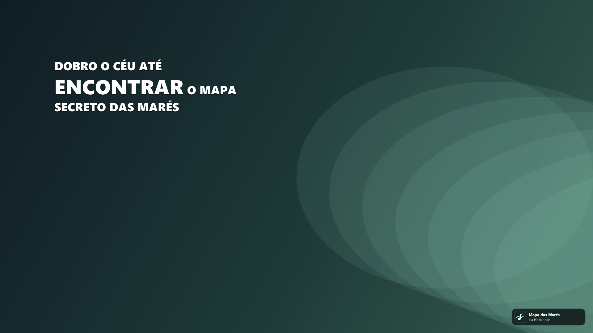
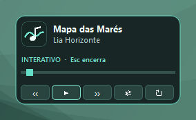
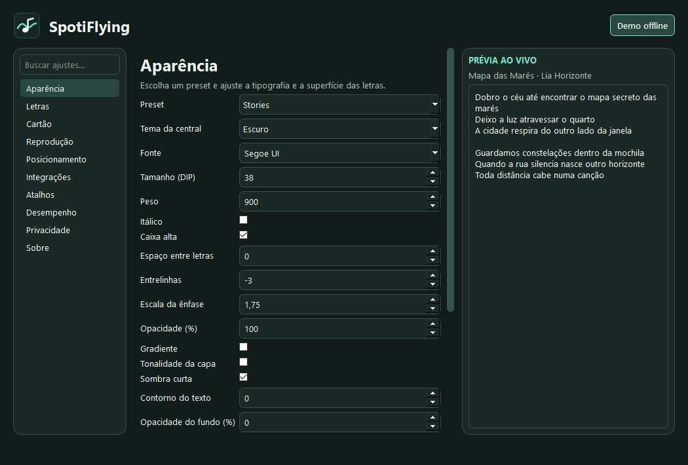

# SpotiFlying

Letras sincronizadas sobre o desktop e um cartão independente para a faixa atual. Aplicativo Windows x64 independente do Spotify.

## Instalação

Veja os downloads em [Releases](https://github.com/GuiPaicheco/SpotiFlying/releases). Os arquivos locais gerados pelo build ficam em `release/`.

- **Instalador** · Execute `SpotiFlying-Setup-x64.exe`. A instalação é por usuário em `%LOCALAPPDATA%\Programs\SpotiFlying`. Remova pelo painel Aplicativos do Windows.
- **Portátil** · Extraia `SpotiFlying-Portable-x64.zip` por completo. Abra `SpotiFlying.exe` na pasta extraída. Mantenha a pasta de dependências junto ao executável.
- **Integridade** · Use `Get-FileHash -Algorithm SHA256` no arquivo baixado e compare com `SHA256SUMS.txt`. Builds sem assinatura podem acionar o SmartScreen.

## Primeiros passos

1. Abra o Spotify Desktop e toque uma faixa. Experimente **Demo offline** na central para explorar com dados fictícios.
2. Em **Letras**, vincule um LRC ou TXT. A consulta opcional ao LRCLIB fica em **Integrações**.
3. Use **Ctrl+Alt+L** para alternar as sobreposições e **Ctrl+Alt+I** para interagir com o cartão. Volte ao modo passivo com **Esc**. A bandeja abre a central, recupera janelas ocultas e encerra o aplicativo.
4. Ajuste fonte, linhas, efeitos e layout pela central. **Restaurar visual da referência** volta ao Stories passivo.

## Capturas

Capturas da demo original, com dados fictícios. Consulte a [matriz de verificação](docs/TECHNICAL.md).

[Stories em fundo claro](docs/screenshots/stories-claro.png)

## Compatibilidade e privacidade

O aplicativo usa janelas normais do Windows. A sobreposição pode ficar indisponível em tela cheia exclusiva, desktop seguro, superfícies protegidas por DRM ou jogos com anti-cheat. O Spotify Desktop precisa expor sua sessão de mídia ao Windows. As capacidades exibidas variam por sessão.

A demo, as configurações, o diagnóstico e a importação de letras são locais. O LRCLIB é opcional e consultado por HTTPS, sem cache persistente. O histórico é local e começa desligado. A verificação de atualizações consulta o GitHub quando solicitada.

- [Guia de uso](docs/USER_GUIDE.md)
- [Detalhes técnicos](docs/TECHNICAL.md)
- [Solução de problemas](docs/TROUBLESHOOTING.md)
- [Contribuição](CONTRIBUTING.md)
- [Histórico de versões](CHANGELOG.md)

Código do projeto sob [MIT](LICENSE). Confira componentes e créditos em [avisos de terceiros](THIRD_PARTY_NOTICES.md).
